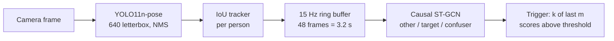

# Orion

Vision work for the **UBC Rover** URC 2027 Autonomy mission: recognise the astronaut's **Follow!** gesture from a camera, on an NVIDIA Jetson Orin NX, using a pose model plus a temporal skeleton classifier. Orion also contains the benchmark harness used to measure those models.

Private repo: [Luxaris/Orion](https://github.com/Luxaris/Orion). Owner: Pranav. Local checkout: `~/projects/ubc-rover/Orion` (beside `RoverFlake2` and `LearnFlake`; `~/projects/ubc-rover-arm` is a compatibility symlink to the parent).

> **Read this file first, then the doc for the task you are doing.** Keep it current: when you change behaviour, artifacts, results or next steps, update the matching section here in the same change.

## Status (2026-11-07)

| Piece | State | Evidence |
|---|---|---|
| Pose model **YOLO11n-pose**, TorchScript 640×640 | Exported and hash-pinned. RTX 5080: FP32 ~2.9 ms per forward; FP16 slower (~4.0 ms). | `notes/POSE_CANDIDATE.md` |
| Hand-wave proxy classifier (`attention_gcn_w48_s0`) | Trained on public skeletons. Test AP 0.65 (NTU 0.70, HMDB in-the-wild 0.16). Not our gesture. | `notes/ATTENTION_RESULTS.md` |
| **Pretrained base** `orion-actions171-base` | 171 actions, val top-1 76.3%, test 66.8%. Fine-tuning it gave val AP 0.71 on the proxy vs 0.55–0.58 from scratch. | `notes/PRETRAIN_RESULTS.md` |
| Recording → dataset → train → export → live tools | Built. Smoke-tested end to end on public lab clips (pipeline only). | `docs/GESTURE_WORKFLOW.md` |
| Portable camera/video kit | CPU video run verified after transfer. Live camera, CUDA kit path and **Jetson are unverified**. | `notes/PORTABLE_INTEGRATION.md` |
| Team gesture model | **Not started: no team recordings yet.** | — |
| Follow! after detection (lock, track, Nav2 follow, stop within 3 m) | **Protocol drafted, nothing implemented.** Depends on RoverFlake2 odometry, twist mux, camera depth and Nav2 bringup. | `docs/FOLLOW_PROTOCOL.md` |

**Nothing here may drive the rover.** No model is validated for our gesture, on YOLO keypoints from our camera, on Jetson, or against continuous-video false-trigger rates.

## The goal and the rules that shape it

URC 2027 Autonomy, astronaut-assistance sub-mission ([Q&A](https://urc.marssociety.org/home/requirements-guidelines/qa)):

- **Q11:** the team picks the gesture; **arm, leg and torso motion only**, no finger or facial gestures. So COCO-17 body keypoints are sufficient.
- **Q10:** the astronaut may stand anywhere and walk up to the camera. **Q12:** any suit colours or patterns. **Q24:** any camera, including one on the astronaut.
- **Q6:** a gesture earns full Follow! points; voice earns 2/3 and is the fallback. Other commands (Stay!, Fetch!, Come!, Give!) may use any method. **Q15:** be quiet during a gestured Follow!.
- A false Follow! makes the rover drive, so **false triggers matter more than misses**.

Proposed gesture (not yet agreed by the team): *two-arm overhead beckon* — both arms straight up, swept down to the chest, three times. Avoid single-arm waving: it is the classifier's most common false alarm.

## Pipeline



- **Keypoints:** COCO-17, image-normalised x, y in [0,1] plus confidence: `[T,17,3]`.
- **Classifier:** `orion_bench/attention_model.py` (`AttentionGCN`), about 1.1M parameters, width 48. Features are body-centred position, confidence, velocity and bone vectors; temporal convolutions are past-only. **Class index 1 is always the target** (`attention` in the proxy, `gesture` in team data).
- **Live demo:** `orion_bench/live_demo.py` reads threshold, target name and window from the classifier's `model_manifest.json` and verifies the artifact SHA-256. The trigger defaults to 6 of the last 8 scored frames.

## Repository map

| Path | What |
|---|---|
| `orion_bench/runner.py`, `backends.py`, `telemetry.py`, `aggregate.py`, `__main__.py` | Benchmark harness (`python -m orion_bench run --config ...`). Reference: `docs/BENCHMARK.md`. |
| `orion_bench/prepare_pose.py` | Hash-verified YOLO11n-pose → TorchScript export, checked numerically against eager output. |
| `orion_bench/temporal_data.py` | Downloads and verifies public PYSKL skeleton pickles and builds ragged-NPZ datasets from a JSON spec. |
| `orion_bench/attention_model.py` | The ST-GCN model and its feature function. |
| `orion_bench/record_gestures.py` | `record` (camera + timed prompts, auto-labelled) and `extract` (existing video + `labels.csv`) team sessions. |
| `orion_bench/team_dataset.py` | Team sessions → dataset, split by **person**. Optionally adds public clips as negatives (public wave → confuser). |
| `orion_bench/live_demo.py` | Headless camera/video pipeline: overlay video, `frames.jsonl`, `summary.json` with triggers and timing. |
| `scripts/train_attention.py` | Training. `--objective detect` (class 1 vs rest, AP, threshold at ≤2% val FPR) or `classify` (top-1). `--init` and `--freeze-steps` for fine-tuning; `--score-test` scores test once. |
| `scripts/eval_attention.py`, `export_attention.py` | Score a frozen run's test split once; export TorchScript plus manifest. |
| `scripts/package_live_kit.py` | Builds `orion-live-kit.tar.gz` with `SHA256SUMS`. |
| `scripts/run_pose_candidate.py`, `smoke_test.py`, `submit_tsp.sh` | Pose benchmark group runner, harness smoke, TSP submission. |
| `examples/` | Harness configs, `yolo11n_pose_pin.json`, `attention_datasets.json` (proxy labels), `pretrain_actions.json` (171 classes). |
| `docs/` | `GESTURE_WORKFLOW.md`, `FINETUNE.md`, `PORTABLE.md` (kit README), `BENCHMARK.md`, `FOLLOW_PROTOCOL.md` (post-detection following with Nav2). |
| `notes/` | Dated protocols, results and handoffs, plus `ledger.csv` (one row per owner or change). |
| `data/`, `models/`, `runs/`, `dist/` | **Git-ignored.** Datasets, weights, run outputs, build products (see below). |

## Artifacts (not in Git)

Weights are distributed as **release assets**; locally they live in ignored directories.

| Artifact | Local path | Release asset | Identity |
|---|---|---|---|
| YOLO11n-pose checkpoint | `models/checkpoints/yolo11/yolo11n-pose.pt` | — (download, below) | HF `Ultralytics/YOLO11` rev `8b8ac7d1…`, SHA-256 `869e83fc…9dc0` |
| YOLO11n-pose TorchScript | `models/yolo11n_pose_640/` | inside `orion-live-kit.tar.gz` | SHA-256 `8e165341…aaa`, AGPL-3.0 |
| Proxy classifier | `models/attention_gcn_w48_s0/` | inside the kit | SHA-256 `db56050c…dc58` |
| Pretrained base | `runs/pretrain/actions171/seed-0/best.pt` | `orion-actions171-base.tar.gz` | checkpoint SHA-256 `b0d29810…cb0` |
| Public skeletons | `data/raw/pyskl/{ntu120,hmdb51}_hrnet.pkl` | — | pinned in `examples/attention_datasets.json` |
| Built datasets | `data/attention_v1`, `data/pretrain_v1` | — | rebuild in about 35 s from the raw pickles |

Rebuild the pose export:

```sh
hf download Ultralytics/YOLO11 yolo11n-pose.pt --revision 8b8ac7d1fae7468f85dbf89670dd66f41f485aab --local-dir models/checkpoints/yolo11
python -m orion_bench.prepare_pose --checkpoint models/checkpoints/yolo11/yolo11n-pose.pt --output-dir models/yolo11n_pose_640 --pin examples/yolo11n_pose_pin.json --imgsz 640
```

Rebuild the datasets (downloads about 1.45 GB the first time):

```sh
python -m orion_bench.temporal_data --spec examples/attention_datasets.json --raw-dir data/raw/pyskl --output-dir data/attention_v1
python -m orion_bench.temporal_data --spec examples/pretrain_actions.json   --raw-dir data/raw/pyskl --output-dir data/pretrain_v1
```

## Environments

- **Workstation** `parsec-ubuntu-vm`: Linux x86-64, RTX 5080 16 GB (shared), Ryzen 9 9950X, 17 GB RAM.
- **Python:** `/home/pranav/projects/ubc-rover/envs/gesture/bin/python` — torch 2.14.1+cu130, ultralytics 8.4.174, OpenCV 5, NumPy 2.5. It has **no pip**; build packages with system `python3 -m pip`. ONNX and onnxruntime are not installed.
- **Install elsewhere:** `pip install orion_rover_benchmark-<ver>-py3-none-any.whl` with extras `[live]`, `[train]`, `[pose]`, `[pytorch]`, `[onnxruntime]`. On Jetson, use NVIDIA's JetPack-matched PyTorch wheel (`docs/PORTABLE.md`).

## Common workflows

**Team gesture** (full guide: `docs/GESTURE_WORKFLOW.md`):

```sh
python -m orion_bench.record_gestures record --pose models/yolo11n_pose_640 --source 0 --person alice --distance 6 --output-dir data/gesture_sessions/alice-6m
python -m orion_bench.team_dataset --sessions data/gesture_sessions --output-dir data/gesture_v1 --val-people carol --test-people dave,erin --public data/attention_v1
python scripts/train_attention.py --data data/gesture_v1 --output-dir runs/gesture/ft --init <base>/best.pt --freeze-steps 500 --window 48 --steps 8000 --lr 0.02
python scripts/eval_attention.py --run runs/gesture/ft/seed-0 --data data/gesture_v1      # test once
python scripts/export_attention.py --run runs/gesture/ft/seed-0 --output-dir models/gesture_ft
python -m orion_bench.live_demo --pose models/yolo11n_pose_640 --classifier models/gesture_ft --source 0 --device cuda --output-dir runs/live/ft
```

**Proxy / pretraining reproduction:**

```sh
python scripts/train_attention.py --data data/attention_v1 --output-dir runs/attention/w48 --window 48 --steps 20000 --eval-every 2500 --seed 0
python scripts/train_attention.py --data data/pretrain_v1 --output-dir runs/pretrain/actions171 --objective classify --window 48 --steps 30000 --eval-every 5000 --score-test
```

Training throughput: one process on the RTX 5080 does about 1,000 steps per 37 s at batch 256. Parallel processes share that rate rather than adding to it, and four processes have run out of 16 GB of GPU memory. Run **at most two at once**; evaluation batches are 512.

**Benchmarks:** `python -m orion_bench run --config examples/yolo11n_pose_cpu.json` or `examples/attention_gcn_cpu.json`. Pose GPU group: `scripts/run_pose_candidate.py` (see `docs/BENCHMARK.md` and `notes/POSE_PROTOCOL.md`).

**Live kit:** `python3 scripts/package_live_kit.py --output "$PWD/dist/orion-live-kit.tar.gz"`. On the target machine, run `sha256sum -c SHA256SUMS` and follow `docs/PORTABLE.md`.

## Working rules

1. **Shared GPU.** Submit GPU work as `tsp -L <Label> gpu-run <cmd>` (cooperative `flock /run/lock/gpu.lock`). Never kill, reorder or remove other people's jobs. The **Thoth** project (`~/projects/Thoth`, tmux pane `Thoth:0` / `%0`) is the main other GPU user.
   - **To get the GPU sooner, ask Pranav first.** If he approves, ask the Thoth owner to pause it safely (its tmux pane is the usual route). It keeps scripts in its `pause/` directories and `RESUME_AFTER_ORION.md`.
   - **Hand back:** when Orion's job finishes, tell Thoth to resume.
   - **tmux input:** type with `tmux send-keys -t %0 -l '<text>'`, then submit with `tmux send-keys -t %0 -H 0d`.
2. **Evaluation discipline.** Write a protocol in `notes/` (data, metrics, pass rule) **before** scoring. Make every choice — checkpoint, threshold, configuration — on validation only. Score the test split **once** per frozen configuration and never change anything because of a test number. Use three seeds for claims. Keep failed and out-of-memory runs and logs.
3. **Splits.** Team data splits by person; public data uses the official splits (NTU cross-subject; validation subjects 4, 17, 27, 38, 49, 56, 74, 84, 95; HMDB split 1). Never mix test people into training or pretraining.
4. **Notes and ledger.** Each change or owner adds a dated `notes/<Name>.md` and a row in `notes/ledger.csv`. Report verdict first, evidence second, and keep one kind of number per column. Mark anything not actually run as unverified.
5. **No rover control.** Don't connect outputs to motion or safety systems until the team's acceptance test passes, e.g. ≥90% of gesture performances trigger within 3 s on held-out people **and** zero triggers in 10 minutes of normal activity with bystanders, on the Jetson.
6. **Licences.** YOLO11n-pose is AGPL-3.0 (or Ultralytics Enterprise). NTU RGB+D 120 is non-commercial research only. HMDB51 is CC BY 4.0. KTH smoke clips (`runs/portable-verification/`) are non-commercial. Keep weights out of Git and the repo private.
7. **Git and releases.** Branch `main`. Commit or push only when asked. Never commit `data/`, `models/`, `runs/` or `dist/`.

## Release procedure

```sh
# bump version in pyproject.toml and the install snippet below; commit; push
rm -rf dist/pkg build *.egg-info
python3 scripts/package_live_kit.py --output "$PWD/dist/orion-live-kit.tar.gz"
python3 -m pip wheel --no-deps -w dist/pkg .
python3 -c "import setuptools.build_meta as b; b.build_sdist('dist/pkg')"
cp dist/orion-live-kit.tar.gz dist/orion-actions171-base.tar.gz dist/pkg/
(cd dist/pkg && sha256sum * > SHA256SUMS)
gh release create vX.Y.Z -R Luxaris/Orion --target main --title "Orion X.Y.Z" --notes "..." dist/pkg/*
```

Verify by downloading the release into a temporary directory, running `sha256sum -c SHA256SUMS`, installing the wheel in a fresh virtual environment and importing `orion_bench`.

Current release **v0.3.0**: wheel, sdist, `orion-live-kit.tar.gz`, `orion-actions171-base.tar.gz`, `SHA256SUMS`.

```sh
gh release download v0.3.0 -R Luxaris/Orion
sha256sum -c SHA256SUMS
pip install ./orion_rover_benchmark-0.3.0-py3-none-any.whl    # or: pip install "git+ssh://git@github.com/Luxaris/Orion.git@v0.3.0"
```

## Next steps (in order)

1. **Team agrees on the gesture**, and records it in `docs/GESTURE_WORKFLOW.md`.
2. **Record at least 5 people.** Vary distance (3–20 m), angle, light, suit and bystanders. Include gesture, other and confuser segments, and continuous normal-activity video for false-trigger testing. Use the rover's own camera and mast height.
3. **Write the protocol**, then fine-tune from `orion-actions171-base` with 3 seeds. Choose threshold and trigger k/m on validation people; test once on held-out people.
4. **Check the pose-source gap.** Compare fine-tuning with and without public negatives, since public skeletons come from HRNet and the rover uses YOLO.
5. **Measure on the real Jetson Orin NX** under the normal robotics load: camera → trigger latency, processed frame rate, memory, power mode. Then consider TensorRT/ONNX export. ONNX tooling is not installed yet.
6. **Integrate with the rover** only after the acceptance test passes, following `docs/FOLLOW_PROTOCOL.md` (interfaces, state machine, Nav2 backend, staged tests T0–T4). Keep voice Follow! as the fallback.

## Known limitations

- **Pose source:** public skeletons are HRNet, not YOLO11n-pose.
- **Gesture coverage:** no public beckoning or leg-waving data. HMDB in-the-wild performance is weak.
- **Tracking:** greedy IoU matching that can swap identities. Gaps longer than 2.5 samples reset the window.
- **Timing:** video timestamps assume the nominal frame rate; cameras use a monotonic clock.
- **TorchScript:** tracing is deprecated in recent PyTorch, and Jetson PyTorch compatibility with these files is untested.
- **Old validation note:** the 32-frame vs 48-frame window comparison also changed the step count, so it doesn't isolate the window effect.
