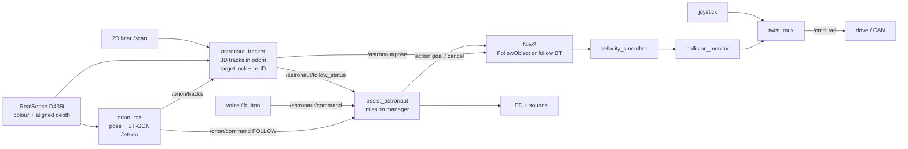
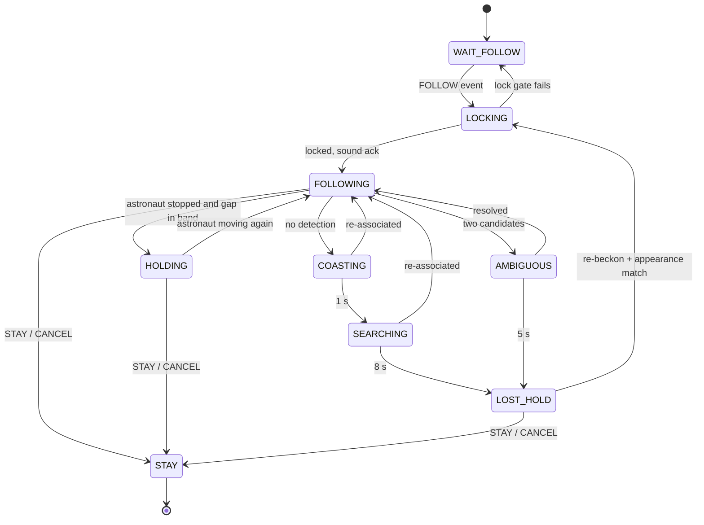

# Follow! protocol: from gesture detection to Nav2 following

Status: **draft, nothing implemented** (2026-11-19). It covers what happens after Orion detects the beckoning gesture: locking onto the astronaut, estimating their position, driving after them with Nav2, stopping within 3 m and handling a lost target. It also lists the RoverFlake2 work it depends on and a pre-registered test protocol.

## 1. Rules this has to satisfy

URC 2027 rule 1.e.vi (quoted in RoverFlake2 issue #243) and the [Q&A](https://urc.marssociety.org/home/requirements-guidelines/qa):

- The astronaut gives Follow!, then walks to a location set during set-up. The rover must **autonomously follow and stop within 3 m when the astronaut stops**. A quiet gesture earns 15 points, voice 10, a sign or device 5 (Q6: this split applies to Follow! only).
- Commands run in order: Follow!, Stay!, Fetch!, Come!, Give! (Q13). Stay! means the rover holds still until the next command, so **Follow! ends when the next command arrives, not when the astronaut stops**.
- No penalty for contact (Q1), but the astronaut may E-stop a rover that gets too close.
- **Judges and spectators walk with the astronaut and rover** (Q22), so the rover must never switch to a bystander.
- The suit may have any colours or patterns (Q12). A distinctive suit is allowed and is the cheapest re-identification cue.
- Interventions: a stop signal from C2 or the astronaut costs 20%, teleoperation 50%. If the rover stops itself, the astronaut may re-issue commands without penalty (Q30, Q32). This protocol therefore prefers **"stop and wait for a re-beckon"** to guessing.
- LED (rule 1.e.ii, issue #237): red while autonomous, blue while teleoperated, flashing green on arrival.

Assumption: the 3 m is measured to the **closest point of the rover**, as for AR posts (Q29). Ask the judges to confirm.

## 2. What exists today (RoverFlake2 `main` as of 2026-11-11, plus branches)

| Need | State | Where |
|---|---|---|
| Nav2 stack (params, bringup, BT) | **Missing.** Only a `nav2_simple_commander` waypoint stub and a reactive `/scan` planner. | `src/rover_search/navigate_waypoints.py`, `src/rover_navigate/simple_planner.py`; issues #221, #79 |
| Odometry with translation | **Missing.** `ukf_local` fuses only IMU orientation and angular rate, so `odom -> base_link` never translates. | `src/localization_dev/config/ukf_local.yaml`; issues #74, #256 (wheel encoders) |
| Global localisation | Draft `ukf_global` (GNSS odom + IMU) and `navsat_transform`. | `src/localization_dev/config/` |
| Robot description, TF | Mini rover URDF with `base_link`, `lidar_scan_link` (Scanse Sweep), IMU and 2 GPS links. **No camera link.** | branch `feat/rowzaw/add_mini_rover_urdf` |
| Velocity path | Joystick `drive_control` publishes `/cmd_vel` directly; the mini rover translator turns `/cmd_vel` into CAN with a 0.5 s stale stop. **No twist mux**, so Nav2 and the joystick would fight over `/cmd_vel`. | `src/drive_control`, `mini_rover_translator.cpp` |
| Depth camera | RealSense D435i and D415 configured as plain UVC video (`cameras_cpp`), **no depth stream**. | `src/cameras_cpp/config/` |
| Camera input for Orion | `cameras_cpp` publishes `/{name}/image_raw_decoded` (names in `config/cameras.json`). Orion reads `/realsense435i/image_raw_decoded` by default (`live_demo --source ros2`). Colour only; the depth topics of the unmerged `cameras.cpp` are not aligned to colour. | `docs/PORTABLE.md` ("ROS 2 camera input") |
| Gesture detection | Orion: YOLO11n-pose + causal ST-GCN, 26 fps on the Jetson Orin NX. Stand-in hand-wave model only; tracker is greedy IoU and swaps IDs often (374 IDs in 13 min live). | this repo |
| LED, sounds | LED issue #237 open; `rover_sounds` package exists. | |

## 3. Architecture



Nodes and owners (proposed):

- **`orion_ros`** (Orion, Jetson). Wraps the `live_demo` pipeline as a ROS 2 node. It publishes per-frame image-space tracks and a **Follow! edge event** carrying the triggering track ID. Orion does not latch or debounce commands; the mission manager does.
- **`astronaut_tracker`** (new, RoverFlake2). Lifts 2D tracks to 3D, keeps its own identity across Orion's ID swaps, locks the target and publishes its pose.
- **`assist_astronaut`** (new, RoverFlake2). The sub-mission state machine. It owns the Nav2 action, the LED and the sounds, and is the only node that starts or stops autonomous motion.
- **Nav2** (Jazzy). Section 6 covers the choice of backend.

## 4. Interfaces

New messages in `rover_msgs`; everything else uses standard types.

```text
# rover_msgs/AstronautCommand.msg
std_msgs/Header header
uint8 FOLLOW=1
uint8 STAY=2
uint8 FETCH=3
uint8 COME=4
uint8 GIVE=5
uint8 CANCEL=6
uint8 command
uint8 GESTURE=1
uint8 VOICE=2
uint8 DEVICE=3
uint8 SIGN=4
uint8 source
int32 track_id          # Orion track that gave the gesture; -1 if not visual
float32 confidence

# rover_msgs/FollowStatus.msg
std_msgs/Header header
uint8 IDLE=0
uint8 LOCKING=1
uint8 FOLLOWING=2
uint8 HOLDING=3
uint8 COASTING=4
uint8 SEARCHING=5
uint8 LOST_HOLD=6
uint8 AMBIGUOUS=7
uint8 state
float32 gap_m           # astronaut torso to closest rover point
float32 target_speed_mps
float32 seconds_since_seen
uint8 range_source      # 0 none, 1 lidar, 2 depth, 3 monocular
```

| Topic | Type | Rate | Producer |
|---|---|---|---|
| `/orion/tracks` | per-track box, COCO-17 keypoints, gesture score (Orion message or JSON-in-String to start) | camera rate | orion_ros |
| `/orion/command` | `rover_msgs/AstronautCommand` (FOLLOW, GESTURE) | edge events | orion_ros |
| `/astronaut/command` | `rover_msgs/AstronautCommand` (voice, button, C2 cancel) | edge events | voice/button nodes |
| `/astronaut/pose` | `geometry_msgs/PoseStamped` in `odom`, torso centre | 15 Hz, **only while locked and fresh (< 0.3 s)** | astronaut_tracker |
| `/astronaut/goal_update` | `geometry_msgs/PoseStamped`, standoff point (BT backend only) | 15 Hz | astronaut_tracker |
| `/astronaut/follow_status` | `rover_msgs/FollowStatus` | 10 Hz | astronaut_tracker |
| `/cmd_vel_nav`, `/cmd_vel_teleop` → `/cmd_vel` | `geometry_msgs/Twist` | | twist_mux, teleop has priority |

Liveness is implicit: when the tracker stops publishing `/astronaut/pose`, Nav2's `detection_timeout` fires. Never republish a stale pose to keep Nav2 happy.

## 5. Protocol

### 5.1 Lock (on a Follow! event)

1. The mission manager accepts FOLLOW only in `WAIT_FOLLOW` or `LOST_HOLD`, and ignores repeats for 5 s (refractory).
2. **Lock gate.** The triggering track must pass all of:
   - both shoulders and both hips visible (confidence ≥ 0.25) and ≥ 9 of 17 keypoints;
   - a valid range from section 5.2, between 1.5 m and 10 m;
   - no other person within 1.0 m of it in 3D.

   On failure, play a "not locked" sound and stay in the current state. The astronaut repeats the gesture; there's no penalty.
3. On success, `astronaut_tracker` creates the **locked target**: 3D position and velocity in `odom`, plus an appearance model (HSV histogram of the torso crop between shoulders and hips).
4. Acknowledge: play a short "locked" sound and keep the LED red. The astronaut starts walking after hearing it. The rover is allowed to make sound; only the astronaut must stay quiet.
5. Send the Nav2 follow goal. The target is to start moving within **2 s of the trigger**.

### 5.2 Range and position

Bearing comes from the torso centre pixel and the camera intrinsics. Range comes from the first source available, in this order:

1. **2D lidar**: the nearest `/scan` cluster within ±3° of the camera bearing, accepted if it agrees with the depth estimate to within 0.5 m (or if there is no depth).
2. **Stereo depth**: the median aligned depth over the torso polygon, accepted if ≥ 30% of its pixels are valid. Stereo error grows roughly with range squared, so treat depth beyond about 6 m outdoors as low quality and test it.
3. **Monocular fallback**: shoulder-to-hip pixel length with a 0.5 m torso prior. It is flagged as low quality, and speed is capped at 50% while it's the only source.

Transform the point into `odom` using the camera's TF. The camera frame has to be added to the URDF, measured on the real mount.

### 5.3 Identity

Orion's IoU tracker IDs aren't stable enough to follow on (the 13-minute live test assigned 374 IDs). `astronaut_tracker` keeps its own target:

- **Prediction:** a constant-velocity Kalman filter in `odom` at 15 Hz.
- **Association:** each new 3D detection is gated by Mahalanobis distance to the prediction. Among detections inside the gate, cost = position term + appearance term (Bhattacharyya distance on the torso histogram).
- **Ambiguity rule:** if two detections pass the gate and their costs are within 20% of each other (for example a judge walking beside the astronaut), **don't choose**. Enter `AMBIGUOUS`, stop and hold until one candidate leaves the gate for 1 s or the astronaut re-beckons.
- **Suit:** use a single saturated colour that nobody else on the field will wear (fluorescent orange or magenta), plus a large high-contrast pattern on the back, since the rover mostly sees the astronaut from behind. Q12 allows any pattern. If the pattern is a fiducial, confirm with the judges by email that it doesn't count as the "sign" command option. We only use it for tracking, not for the command.

### 5.4 Follow, hold, resume

Gap = distance from the astronaut's torso centre to the closest point of the rover footprint.

| Parameter | Value | Why |
|---|---|---|
| target gap | 1.8 m | 1.2 m of margin under the 3 m rule |
| hold band | 1.2 to 2.5 m | stops always land under 3 m with 0.5 m spare |
| hard stop | any person (not just the target) closer than 1.0 m | collision_monitor stop zone |
| max speed | 1.0 m/s (mini rover lower) | the astronaut walks at about 0.8 m/s by agreement |
| astronaut "stopped" | speed < 0.2 m/s over 1.5 s | Kalman velocity in `odom` |
| astronaut "moving again" | 0.75 m from the stop anchor, or > 0.4 m/s for 0.5 s | hysteresis against fidgeting |

- `FOLLOWING`: Nav2 tracks the target at the target gap.
- `HOLDING`: when the astronaut has stopped and the gap is within the hold band, stop (zero velocity, Nav2 goal held, not cancelled) and **flash green**.
- Leave `HOLDING` for `FOLLOWING` when the astronaut is moving again.
- **Follow! ends only on the next command** (Stay! by voice or button, or CANCEL from C2). The manager then cancels the Nav2 action, the commanded velocity drops to zero, and the lock is released.

### 5.5 Lost target

| Time since the last associated detection | State | Behaviour |
|---|---|---|
| < 1.0 s | `COASTING` | keep going toward the predicted position at ≤ 50% speed |
| 1.0 to 8.0 s | `SEARCHING` | stop translating; rotate up to ±45° toward the last bearing; associate only against the stored appearance and predicted region |
| > 8.0 s, or AMBIGUOUS for > 5 s | `LOST_HOLD` | stop and keep the LED red (the rover is still autonomous). Wait for a re-beckon from any person who passes the lock gate **and** matches the stored appearance |

A re-beckon after the rover stopped itself is free under Q30/Q32, so `LOST_HOLD` is a safe default rather than a failure.

### 5.6 State machine



From any state, joystick input switches to teleop: the mux gives priority to the joystick, the LED turns blue and the manager cancels the action. A hardware E-stop cuts power.

## 6. Nav2 backend

Both backends consume the same tracker output, so the choice doesn't change sections 4 and 5.

| | **Following Server** (`opennav_following`, `FollowObject` action) | **Follow BT** (`follow_point.xml`: GoalUpdater + ComputePathToPose + TruncatePath + FollowPath) |
|---|---|---|
| In Jazzy | yes, `nav2_following/opennav_following` 1.3.14 in the jazzy branch | yes, ships with `nav2_bt_navigator` |
| Needs | `odom` TF, `/astronaut/pose`, odometry topic | plus global and local costmaps, a tuned planner and controller |
| Obstacles | smooth control law straight at the target; optional collision check **stops**, doesn't go around | replans around rocks at the BT rate |
| Distance keeping | `desired_distance` built in, `detection_timeout`, rotate-to-search | `TruncatePath distance`; the goal must be the standoff point (`/astronaut/goal_update`), because the person's own cell is an obstacle in the costmap |
| Use for | mini rover bring-up on flat ground | full rover on MDRS terrain |

Recommendation: **start with the Following Server** on the mini rover. It needs only odometry, TF and the pose topic, so it can be tested before the costmaps exist. Switch to the BT backend once the route-finding work (#244) has working costmaps. Starting Following Server parameters for the mini rover:

```yaml
following_server:
  ros__parameters:
    base_frame: base_link
    fixed_frame: odom
    desired_distance: 2.1        # target gap 1.8 m + base_link-to-front offset (measure; 0.3 m assumed)
    detection_timeout: 1.0       # COASTING window
    rotate_to_object_timeout: 7.0
    search_by_rotating: true
    search_angle: 0.785          # ±45°
    static_object_timeout: -1.0  # astronaut stopping is HOLDING, not the end of Follow!
    filter_coef: 0.3
    controller:
      v_linear_max: 0.6
      v_angular_max: 0.8
      use_collision_detection: true
```

Behaviour the server doesn't provide (the hold band, ambiguity holds, re-beckon and appearance matching) stays in `astronaut_tracker` and `assist_astronaut`.

## 7. Prerequisites in RoverFlake2, in order

1. **Translational odometry.** Wheel encoders (#256, #74) fused in `ukf_local`, or visual odometry from the D435i if the encoders are late. Without it, `odom` doesn't move and target velocity, "stopped" detection and coasting all fail.
2. **twist_mux** with teleop priority, plus Nav2 `velocity_smoother` → `collision_monitor` (stop zone: footprint + 1.0 m in front) → mux → `/cmd_vel`.
3. **Camera TF and depth.** Add the camera link to the URDF. Run `realsense2_camera` with colour, aligned depth and `camera_info`, instead of UVC-only `cameras_cpp`, for the following camera.
4. **Nav2 bringup** for the mini rover: lifecycle manager, Following Server, collision monitor; costmaps later.
5. **LED driver** (#237) and the `rover_sounds` lock / not-locked cues.
6. **`orion_ros`** node publishing `/orion/tracks` and `/orion/command`.

## 8. Test protocol (fixed before any scoring)

Ground truth: the stopping gap is measured with a tape from the astronaut's torso to the closest point of the rover, and the run is recorded with a rosbag. A run counts only if it is on the bag. Thresholds are fixed now and are not tuned on test runs.

| Stage | Setup | Runs | Pass rule |
|---|---|---|---|
| T0 replay | rosbags of people walking past the mini rover, replayed through `astronaut_tracker` | 10 bags | 0 identity switches on the locked target; AMBIGUOUS entered on every pass-beside event |
| T1 follow | mini rover, flat field, one astronaut, 30 m walk with 2 stops | 20 | **every stop gap ≤ 2.5 m**; minimum gap ≥ 1.0 m; motion within 2 s of the trigger in 19/20 |
| T2 bystanders | T1 plus 2 people walking beside, and one crossing between the rover and the astronaut | 20 | **0 follows of a bystander**; a crossing ends in FOLLOWING (same target) or AMBIGUOUS/LOST_HOLD, never in following the crosser |
| T3 loss | astronaut steps out of view for 10 s, then re-beckons | 10 | rover stops within 1 s of SEARCHING ending; re-lock within 5 s of the re-beckon in 9/10 |
| T4 terrain | full rover, rocks between the rover and the astronaut's path | 10 | no contact; every stop gap ≤ 2.5 m |

Before any motion test, Orion's own gate applies (README rule 5): ≥ 90% of gesture performances trigger within 3 s on held-out people, and **zero false triggers in 10 minutes** of normal activity with bystanders, on the Jetson.

## 9. Decisions for the team

1. The gesture. Proposed: two-arm overhead beckon (see the README).
2. The channel for Stay!/Come!/Fetch!/Give!: voice or the astronaut's button device. Follow! needs a non-gesture fallback (voice, 2/3 points).
3. Suit colour and back pattern, and whether to ask the judges about a fiducial.
4. Who owns `astronaut_tracker` and `assist_astronaut` (#243 assignees: @Yeetbananis, @Ekko656; Nav2 exploration #221: @Yeetbananis).
5. Speed cap for the full rover versus the astronaut's agreed walking speed.
